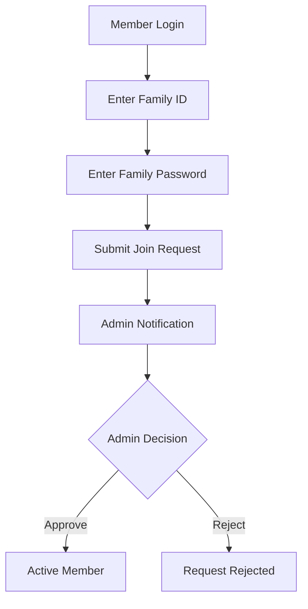
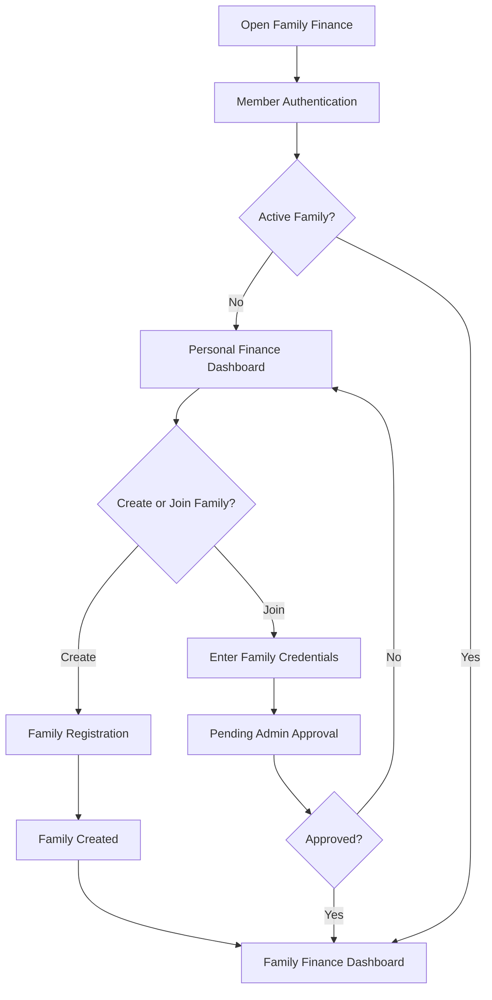
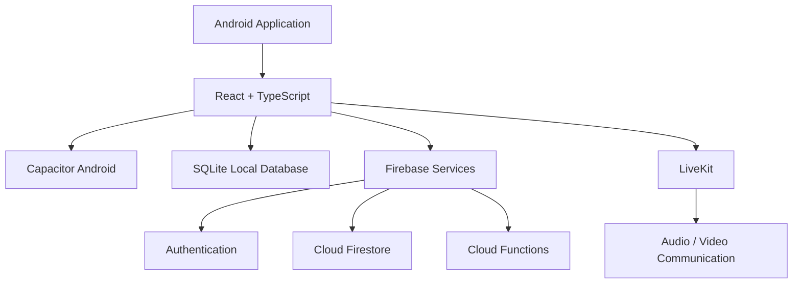
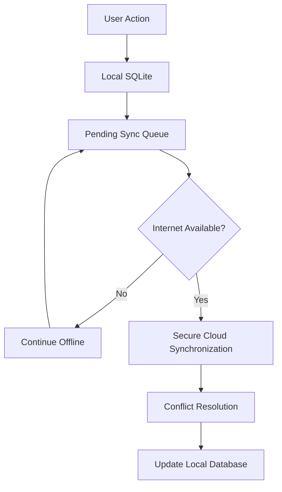

 <div align="center">

  

  <br>
  <hr>
  <br>

  
  # Family Finance

  **Plan • Track • Grow Together**

  A smarter way to manage personal and family finances.

  <br>

  
  
  
  
  
  

</div>

---

## 📌 Table of Contents

- [Overview](#-overview)
- [Project Vision](#-project-vision)
- [Core Features](#-core-features)
- [Authentication System](#-authentication-system)
- [Family Management](#-family-management)
- [Financial Management](#-financial-management)
- [Personal Finance vs Family Finance](#-personal-finance-vs-family-finance)
- [Application Workflow](#-application-workflow)
- [Technology Stack](#-technology-stack)
- [System Architecture](#-system-architecture)
- [Security and Privacy](#-security-and-privacy)
- [Android Application](#-android-application)
- [Project Structure](#-project-structure)
- [Development Roadmap](#-development-roadmap)
- [Future Improvements](#-future-improvements)
- [License](#-license)

---

## 🌿 Overview

**Family Finance** is an Android-based financial management application designed to help individuals and families organize, monitor, and manage their financial activities in one place.

It provides separate financial environments for personal and family use, allowing users to manage income, expenses, loans, savings, investments, budgets, and financial reports.

The application focuses on:

- Financial transparency
- Secure family collaboration
- Accurate financial records
- Personal and family financial separation
- Offline-first data management
- Simple and intuitive user experience

### Project Information

| Item | Details |
|---|---|
| Project Name | Family Finance |
| Repository | Family-Finance-App |
| Platform | Android |
| Application Type | Finance Management |
| Currency | BDT (৳) |
| Development Assistance | Google AI Studio |
| Frontend | React + TypeScript |
| Native Integration | Capacitor |
| Local Database | SQLite |
| Cloud Services | Firebase |

---

## 🎯 Project Vision

The goal is to build a reliable financial platform where individuals can manage their own finances and, after joining a family, collaborate with other approved members.

### Main Objectives

1. Simplify personal and family financial management.
2. Maintain transparent family financial records.
3. Track income, expenses, loans, savings, and investments.
4. Provide accurate financial summaries and reports.
5. Support secure membership and family administration.
6. Allow financial activities even without an internet connection.
7. Synchronize data securely across devices.

---

## 🚀 Core Features

| Feature | Description |
|---|---|
| Personal Finance | Manage individual financial activities |
| Family Finance | Shared family financial management |
| Member Authentication | OTP and Passkey login |
| Family Registration | Create a new family |
| Family Management | Manage family information and members |
| Member Approval | Approve or reject membership requests |
| Income Tracking | Record and categorize income |
| Expense Tracking | Monitor spending |
| Loan Management | Track borrowed and lent money |
| Savings Management | Manage savings and goals |
| Investment Tracking | Monitor investment principal and returns |
| Budget Management | Set and monitor budgets |
| Dashboard | View financial summaries |
| Reports | Monthly and yearly reports |
| Notifications | Receive important updates |
| Family Chat | Communicate with family members |
| Audio/Video Calls | Conduct family meetings |
| Offline Mode | Work with locally stored data |
| Cloud Synchronization | Synchronize financial records |

---

## 🔐 Authentication System

Family Finance has two separate but connected systems.

### 1. Member Registration & Login

Each individual has a personal member account.

**Registration Information**

- Full Name
- Mobile Number
- Date of Birth
- SMS OTP Verification

**Login Methods**

- Mobile Number + SMS OTP
- Registered Passkey

The verified mobile number is the Member ID.

No separate random Member ID or traditional personal account password is generated.

### 2. Family Registration & Login

A Family is a separate entity, not a personal user account.

Family creation requires:

- Family Name
- Optional Description
- Family Password
- Password Confirmation

After successful creation:

- A unique Family ID is generated.
- The creator becomes the first Family Admin.
- The creator becomes an active family member.

### Family ID Rules

| Property | Requirement |
|---|---|
| Length | Exactly 12 characters |
| Characters | A–Z and 0–9 |
| Generation | Cryptographically secure random generation |
| Uniqueness | Globally unique |
| Modification | Permanent and non-editable |
| Security | Identifier only, not an authentication secret |

Uniqueness must be enforced by a trusted backend/database using atomic constraints and collision retry.

### Family Password

Family Password is separate from personal authentication.

It is used for:

- Family creation
- Joining a family
- Protected Family Management access

Passwords must be stored as secure salted hashes, never as plaintext.

---

## 👨‍👩‍👧‍👦 Family Management

### Joining a Family

A registered and authenticated member can request to join a family.

**Membership Process**

1. Log in to the personal account.
2. Enter the Family ID.
3. Enter the Family Password.
4. Submit a membership request.
5. Wait for Admin approval.
6. Become an active family member after approval.



### Family Admin

The family creator automatically becomes the first Admin.

**Admin Responsibilities**

- Approve or reject member requests.
- Manage family members.
- Access protected Family Management features.
- Change the Family Password.
- Transfer Admin responsibility to another active member.

Only one active Admin is allowed per family.

Admin transfer must require proper authorization, atomic backend updates, and audit logging.

### Membership States

| State | Description |
|---|---|
| No Family | Not associated with a family |
| Pending Request | Waiting for Admin approval |
| Active Member | Approved family member |
| Removed | Removed from the family |
| Suspended | Temporarily restricted |

---

## 💰 Financial Management

### Income Management

- Add income records.
- Categorize income.
- Track income history.
- View income summaries.

### Expense Management

- Record daily expenses.
- Organize expense categories.
- Track spending patterns.
- Analyze monthly expenses.

### Loan Management

- Track borrowed money.
- Track lent money.
- Record repayments.
- Monitor outstanding balances.

### Savings Management

- Create savings goals.
- Track deposits and withdrawals.
- Monitor savings progress.

### Investment Management

- Record investment principal.
- Track investment performance.
- Separate investment profit and loss.
- Monitor investment history.

### Budget Management

- Create monthly budgets.
- Set category-wise limits.
- Monitor spending.
- Track remaining budgets.

### Reports & Analytics

- Daily financial overview
- Monthly reports
- Yearly reports
- Income and expense analysis
- Savings progress
- Investment performance
- PDF report export

### Financial Accuracy Rules

Financial records must follow proper accounting logic.

- Loan principal received is not ordinary income.
- Loan principal repayment is not ordinary expense.
- Savings transfers are not new income.
- Investment principal is not investment profit.
- Personal and family balances remain separate.
- Duplicate transactions must be prevented.
- Calculations should use integer minor units or decimal-safe representations.

---

## 🔄 Personal Finance vs Family Finance

The active financial environment depends on the user's family membership status.

| Membership Status | Active System |
|---|---|
| No Family | Personal Finance |
| Pending Request | Personal Finance |
| Active Member | Family Finance |
| Removed / Suspended | Restricted Family Access |

### Important Data Separation

- Personal financial records remain independently owned.
- Joining a family does not automatically merge personal records.
- Personal historical records remain available as read-only history after switching to Family Finance.
- Family Finance begins with its own actual transactions and opening balances.
- Personal money transferred into a family must be recorded as an explicit Family Contribution.
- Removed or suspended members lose active family access, while authorized historical records are preserved.

---

## 🧭 Application Workflow



---

## 🛠️ Technology Stack

| Technology | Purpose |
|---|---|
| React | User Interface |
| TypeScript | Application Logic |
| Capacitor | Android Native Integration |
| SQLite | Local Database |
| Firebase Authentication | Supported Authentication Services |
| Firebase Firestore | Cloud Database |
| Firebase Cloud Functions | Trusted Backend Operations |
| LiveKit | Real-time Audio/Video |
| Google AI Studio | AI-Assisted Development |
| Android Studio | Android Build and Testing |

### Development Environment

- Windows
- Visual Studio Code
- Node.js and npm
- Android Studio
- Android Emulator
- Git and GitHub

---

## 🏗️ System Architecture



### Offline-First Synchronization



---

## 🛡️ Security and Privacy

Security and data privacy are essential parts of Family Finance.

- SMS OTP verification
- Passkey authentication support
- Secure Family Password hashing
- Family-specific data isolation
- Backend-enforced authorization
- Firebase Security Rules
- Role-based access control
- Audit logs for sensitive operations
- Secure Admin transfer
- Protected membership approval
- Duplicate transaction prevention
- Offline synchronization protection
- No exposed API secrets in the Android application

**Important:** Family ID alone must never grant access to family data. All sensitive operations must be validated by trusted backend services.

---

## 📱 Android Application

Family Finance is designed exclusively for Android.

### Build Outputs

| Format | Purpose |
|---|---|
| APK | Direct installation and testing |
| AAB | Google Play Store distribution |

The project does not target:

- Web Application
- Progressive Web App (PWA)
- Windows Desktop
- macOS Desktop
- Electron
- EXE or DMG applications

---

## 📂 Project Structure

The following is an illustrative project structure.

```text
Family-Finance-App/
│
├── android/
│
├── assets/
│   ├── banner.png
│   └── FamilyFinance-Icon.png
│
├── public/
│
├── src/
│   ├── components/
│   ├── screens/
│   ├── navigation/
│   ├── services/
│   ├── database/
│   ├── hooks/
│   ├── contexts/
│   ├── types/
│   └── utils/
│
├── capacitor.config.ts
├── package.json
├── tsconfig.json
└── README.md
```

*The actual structure may change during development.*

---

## 🗺️ Development Roadmap

Development progress will be updated as features are implemented and tested.

### Phase 1 — Foundation

- [ ] Project setup
- [ ] Application architecture
- [ ] UI/UX design system
- [ ] Android integration

### Phase 2 — Authentication

- [ ] Member registration
- [ ] SMS OTP authentication
- [ ] Passkey support
- [ ] Family registration
- [ ] Family ID generation

### Phase 3 — Family Management

- [ ] Join family workflow
- [ ] Membership approval
- [ ] Family Admin system
- [ ] Admin transfer
- [ ] Member management

### Phase 4 — Financial System

- [ ] Personal Finance
- [ ] Family Finance
- [ ] Income management
- [ ] Expense management
- [ ] Loan management
- [ ] Savings management
- [ ] Investment management
- [ ] Budget management

### Phase 5 — Advanced Features

- [ ] Dashboard and analytics
- [ ] Financial reports
- [ ] PDF export
- [ ] Offline database
- [ ] Cloud synchronization
- [ ] Notifications
- [ ] Family chat
- [ ] Audio/Video calls

### Phase 6 — Release

- [ ] Security audit
- [ ] Testing and bug fixing
- [ ] Performance optimization
- [ ] APK generation
- [ ] AAB generation
- [ ] Release preparation

---

## 🔮 Future Improvements

Potential future improvements include:

- Advanced financial analytics
- Recurring transactions
- Smart budget insights
- Improved backup and recovery
- Multi-language support
- Advanced family financial reports
- More powerful financial planning tools

---

## 🤝 Contribution

Suggestions, bug reports, and improvements are welcome.

For major changes, open an issue first to discuss the proposed changes.

---

## 📄 License

License information will be added after selecting an appropriate project license.

---

<div align="center">

  

  ### Family Finance

  **Plan • Track • Grow Together**

  Built to make family financial management simpler.

</div>